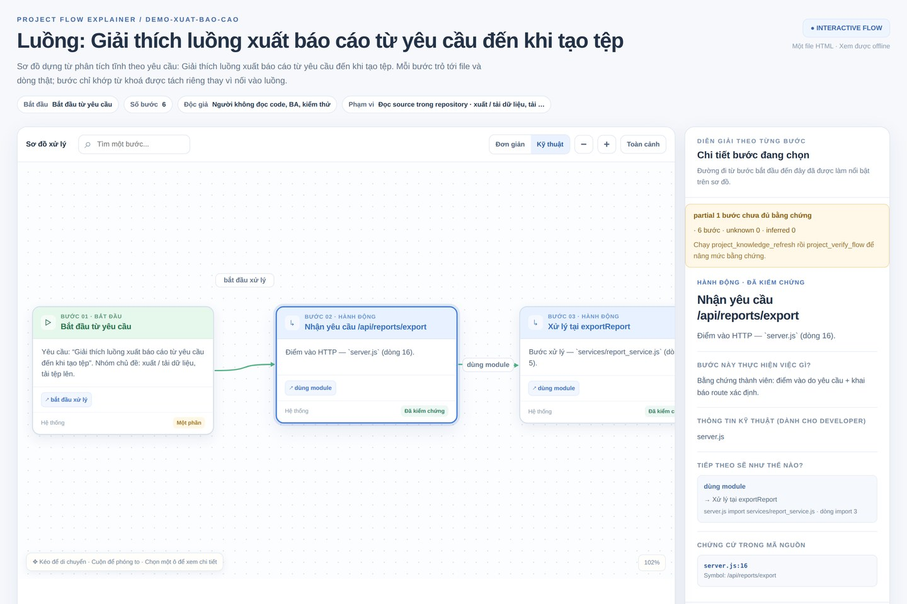

# Project Flow Explainer

[](https://github.com/Hieupt1904/project-flow-explainer/actions/workflows/ci.yml) [](https://www.npmjs.com/package/dsh-project-flow-explainer)

**Biến một câu hỏi về mã nguồn thành sơ đồ tương tác mở được khi ngoại tuyến.** Chọn một bước để xem căn cứ: tệp, dòng mã và mức độ xác minh.

[Bản đồ toàn kho](#bản-đồ-toàn-kho) · [Chạy thử với Python](#chạy-thử-với-python) · [Dùng trong DeepSeek Harness](#dùng-trong-deepseek-harness) · [Hướng dẫn sử dụng](USAGE_GUIDE.md)



**ĐÃ TRIỂN KHAI** — Project Flow Explainer có hai chế độ xem. Chọn bản đồ toàn kho để khám phá kiến trúc. Chọn sơ đồ nghiệp vụ để lần theo từng nhánh và đối chiếu dòng mã.

## Bản ổn định 0.10.0

Cài bản ổn định từ npm bằng thẻ `latest`.

```bash
dsh plugin --profile pfe-test add dsh-project-flow-explainer@latest
```

Xem [ghi chú phát hành](CHANGELOG.md) hoặc tải [gói cài từ GitHub](https://github.com/Hieupt1904/project-flow-explainer/releases/tag/v0.10.0).

## Bản đồ toàn kho

Dùng Node.js 20 trở lên và Git để dựng bản đồ. Khi dựng xong, mở `project-flow-explainer/index.html` bằng trình duyệt.

```bash
node scripts/project_map.mjs build "$PWD"
node scripts/project_map.mjs refresh "$PWD"
node scripts/project_map.mjs serve "$PWD"
node scripts/project_map.mjs export "$PWD"
```

Bản đồ liệt kê phân hệ, tệp, đường dẫn web và các quan hệ tĩnh. Thanh trên có **Sức khỏe**, **Việc gần đây**, **Màn hình** khi nhận diện được màn hình, **Bắt đầu**, **Luồng** và **Xuất**.

Khi mở trực tiếp tệp HTML, bạn vẫn xem được bản đồ và các luồng đã lưu. Để bật thanh **Hỏi**, hãy chạy một trong hai lệnh sau từ thư mục gốc của kho mã. Sau đó, mở địa chỉ máy chủ in ra.

| Cách hỏi | Lệnh | Nguồn trả lời |
|---|---|---|
| Bản đồ cục bộ | `node project-flow-explainer/serve.mjs --no-open` | Tra cứu dữ liệu bản đồ tại máy, không cần mô hình. |
| DeepSeek Harness (DSH) | `node project-flow-explainer/serve.mjs --no-open --agent` | Chọn mô hình từ hồ sơ `web`. DSH chạy câu hỏi bằng `headless` với lựa chọn đó. |

Trong chế độ DSH, bộ chọn **Mô hình DSH** phân biệt các mô hình trùng tên theo nhà cung cấp. Tải lại trang sau khi thêm mô hình. DSH dùng thông tin xác thực đã lưu; bản đồ không trả giá trị khóa về trình duyệt.

Dùng `export` để tạo `project-flow-explainer/share.html`. Bản chia sẻ chỉ để xem và ẩn thanh **Hỏi**.

Để tạo bản phác, lưu đặc tả có cấu trúc vào `project-flow-explainer/plan.json`, rồi chạy `node scripts/project_map.mjs plan "$PWD"`. Bản phác phân biệt phần dự kiến với mã đã có.

Nếu chưa có thư mục mới, `build` hoặc `refresh` chuyển bản đồ cũ đã nhận diện sang tên mới. Công cụ giữ cấu hình, mô tả và luồng đã lưu. Với thư mục cũ có tệp do Git theo dõi, hãy sao lưu và chuyển dữ liệu thủ công.

Xem [ghi chú nguồn thư viện tích hợp](vendor/project-flow-explainer/UPSTREAM.md).

## Chạy thử với Python

Dùng Python 3.12 và Git. Lõi Python chỉ dùng thư viện chuẩn. Cài Node.js 20 trở lên để dùng trình xem mới; nếu thiếu Node.js, trình dựng dùng giao diện dự phòng.

```bash
git clone https://github.com/Hieupt1904/project-flow-explainer.git
cd project-flow-explainer

demo_dir=$(mktemp -d)
cp -R tests/fixtures/shop-app "$demo_dir/shop-app"
repo="$demo_dir/shop-app"
git -C "$repo" init -q
python3 scripts/build_flow.py --repo "$repo" \
  --request 'Giải thích luồng xuất báo cáo từ yêu cầu đến khi tạo tệp' \
  --slug demo-xuat-bao-cao
printf '%s\n' "$repo/artifacts/flows/demo-xuat-bao-cao/flow.html"
```

Mở đường dẫn lệnh in ra trong trình duyệt. Chọn một bước trên **Bản đồ** để xem tệp và dòng mã. Với dự án của bạn, dùng đường dẫn tuyệt đối cho `--repo` và mô tả một luồng cụ thể.


### Tệp kết quả

Công cụ lưu kết quả trong `<repo>/artifacts/flows/<slug>/`.

| Tệp | Dùng để |
|---|---|
| `flow.html` | Xem, tìm kiếm và khám phá sơ đồ ngoại tuyến. |
| `flow.json` | Đọc dữ liệu sơ đồ hoặc tạo lại bản HTML. |
| `overview.md` | Đọc phần tóm tắt, căn cứ và giới hạn phân tích. |
| `run.json` | Lưu thông tin truy vết của lần chạy. Tệp này dùng nội bộ. |

## Dùng trong DeepSeek Harness

**ĐÃ TRIỂN KHAI** — Plugin DeepSeek Harness (DSH) dùng cùng lõi Python. Cài vào hồ sơ DSH bạn muốn dùng, rồi khởi động lại DSH:

```bash
dsh plugin --profile pfe-test add dsh-project-flow-explainer@latest
```

Trong giao diện web, mở **Plugins → Project Flow Explainer → Configure** tại dòng `project-flow-explainer`. Thêm đường dẫn tuyệt đối của thư mục làm việc vào **Thư mục được đọc** (`allowedRoots`), rồi chọn **Lưu cấu hình**. Sau đó nhập:

```text
/project-flow-explainer Giải thích luồng xuất báo cáo
/project-flow-explainer --map
/project-flow-explainer --refresh-map
/project-flow-explainer --blueprint
```

Lệnh mặc định phân tích thư mục làm việc của phiên. `--blueprint` dựng bản phác từ `project-flow-explainer/plan.json` đã có. Xem [README của plugin](dsh-plugin/README.md) để biết phiên bản tương thích, cách chỉ định kho mã khác và cách cài từ tệp gói.

## Tra cứu trước và sau khi sửa mã

**ĐÃ TRIỂN KHAI** — Chỉ mục cục bộ giúp tìm điểm vào, tệp liên quan và kiểm thử cần xem. Ví dụ dưới đây tiếp nối phần dùng thử:

```bash
python3 tools/pfe_cli.py index --repo "$repo" --mode full
python3 tools/pfe_cli.py search --repo "$repo" --query 'exportReport'
python3 tools/pfe_cli.py context-pack --repo "$repo" --task 'Sửa luồng xuất báo cáo'
python3 tools/pfe_cli.py impact --repo "$repo" --changed services/report_service.js
python3 tools/pfe_cli.py refresh --repo "$repo"
python3 tools/pfe_cli.py verify --repo "$repo"
```

Chỉ mục nằm trong `<repo>/.pfe/index/`. Để làm mới sau khi sửa, chạy `refresh`; lệnh này mặc định cập nhật tăng dần. Không đưa chỉ mục cục bộ vào Git.

## Đọc đúng mức độ xác minh

- Bước dựng bản đồ và sơ đồ luồng chạy tại máy, không chạy ứng dụng đích. Chế độ hỏi qua mô hình là tùy chọn riêng.
- Nhãn `verified` trong sơ đồ xác nhận vị trí và căn cứ trong mã nguồn, không xác nhận hành vi khi chạy.
- Quan hệ `import` không chứng minh thứ tự gọi hàm. Công cụ tách tệp chỉ khớp từ khóa khỏi sơ đồ luồng.
- `static_verdict` và `overall_verdict` là hai kết quả riêng. Kiểm tra tĩnh đạt không thay thế kiểm thử giao diện hoặc ứng dụng.

## Phát triển và kiểm thử

Chạy bộ kiểm thử lõi, mô hình trình xem và plugin. [Bản ghi phát hành 0.7.11](artifacts/review/evidence-manifest.json) ghi 209 ca kiểm thử Python của phiên bản đó.

```bash
python3 -m unittest discover -s tests
node --test dsh-plugin/tests/*.test.mjs tests/viewer-model.test.mjs tests/project-map-integration.test.mjs
python3 scripts/check_repo_policy.py
```

Để kiểm thử giao diện, dùng môi trường Python đã có Playwright và Chromium. Chạy `python3 tests/browser_project_map.py` cho Project Flow Explainer và `python3 tests/browser_viewer.py` cho trình xem dự phòng. Đặt `PFE_BROWSER` thành đường dẫn Chrome nếu dùng bản đã cài trên máy.

- [Quyết định kiến trúc](ARCHITECTURE_DECISION.md) — cách lõi Python và plugin dùng chung dữ kiện tĩnh.
- [Gói tài liệu rà soát](REVIEW_PACKET.md) — phạm vi kiểm tra và bằng chứng theo từng bản phát hành.
- [Lịch sử phát hành](https://github.com/Hieupt1904/project-flow-explainer/releases) — tải các bản đóng gói.
