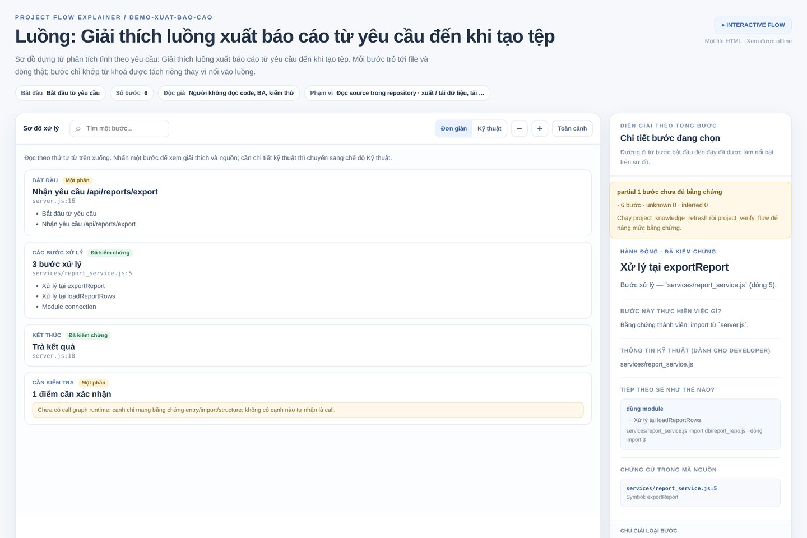

# Project Flow Explainer

[](https://github.com/Hieupt1904/project-flow-explainer/actions/workflows/ci.yml) [](https://www.npmjs.com/package/dsh-project-flow-explainer)

**Biến một câu hỏi về mã nguồn thành sơ đồ tương tác mở được khi ngoại tuyến.** Chọn một bước để xem căn cứ: tệp, dòng mã và mức độ xác minh.

[Chạy thử với Python](#chạy-thử-với-python) · [Dùng trong DeepSeek Harness](#dùng-trong-deepseek-harness) · [Hướng dẫn sử dụng](USAGE_GUIDE.md)



*Ảnh chụp từ kho mã mẫu trong dự án. Chế độ **Đơn giản** nhóm các bước; chế độ **Kỹ thuật** hiển thị từng nút và đường nối.*

## Chạy thử với Python

Dùng Python 3.12 và Git. Lõi Python chỉ dùng thư viện chuẩn.

```bash
git clone https://github.com/Hieupt1904/project-flow-explainer.git
cd project-flow-explainer

demo_dir=$(mktemp -d)
cp -R tests/fixtures/shop-app "$demo_dir/shop-app"
repo="$demo_dir/shop-app"
git -C "$repo" init -q
python3 scripts/build_flow.py --repo "$repo" \
  --request 'Giải thích luồng xuất báo cáo từ yêu cầu đến khi tạo tệp' \
  --slug demo-xuat-bao-cao
printf '%s\n' "$repo/artifacts/flows/demo-xuat-bao-cao/flow.html"
```

Mở đường dẫn lệnh in ra trong trình duyệt. Chọn **Kỹ thuật**, rồi chọn một nút để xem căn cứ mã nguồn. Với dự án của bạn, thay `--repo` bằng đường dẫn tuyệt đối và mô tả một luồng cụ thể.


### Tệp kết quả

Công cụ lưu kết quả trong `<repo>/artifacts/flows/<slug>/`.

| Tệp | Dùng để |
|---|---|
| `flow.html` | Xem, tìm kiếm và khám phá sơ đồ ngoại tuyến. |
| `flow.json` | Đọc dữ liệu sơ đồ hoặc tạo lại bản HTML. |
| `overview.md` | Đọc phần tóm tắt, căn cứ và giới hạn phân tích. |
| `run.json` | Lưu thông tin truy vết của lần chạy. Tệp này dùng nội bộ. |

## Dùng trong DeepSeek Harness

**ĐÃ TRIỂN KHAI** — Plugin DeepSeek Harness (DSH) dùng cùng lõi Python. Cài vào hồ sơ DSH bạn muốn dùng, rồi khởi động lại DSH:

```bash
dsh plugin --profile pfe-test add dsh-project-flow-explainer@latest
```

Trong giao diện web, mở **Plugins → Project Flow Explainer → Configure** tại dòng `project-flow-explainer`. Thêm đường dẫn tuyệt đối của thư mục làm việc vào **Thư mục được đọc** (`allowedRoots`), rồi chọn **Lưu cấu hình**. Sau đó nhập:

```text
/project-flow-explainer Giải thích luồng xuất báo cáo
```

Lệnh mặc định phân tích thư mục làm việc của phiên. Xem [README của plugin](dsh-plugin/README.md) để biết phiên bản tương thích, cách chỉ định kho mã khác và cách cài từ tệp gói.

## Tra cứu trước và sau khi sửa mã

**ĐÃ TRIỂN KHAI** — Chỉ mục cục bộ giúp tìm điểm vào, tệp liên quan và kiểm thử cần xem. Ví dụ dưới đây tiếp nối phần dùng thử:

```bash
python3 tools/pfe_cli.py index --repo "$repo" --mode full
python3 tools/pfe_cli.py search --repo "$repo" --query 'exportReport'
python3 tools/pfe_cli.py context-pack --repo "$repo" --task 'Sửa luồng xuất báo cáo'
python3 tools/pfe_cli.py impact --repo "$repo" --changed services/report_service.js
python3 tools/pfe_cli.py refresh --repo "$repo"
python3 tools/pfe_cli.py verify --repo "$repo"
```

Chỉ mục nằm trong `<repo>/.pfe/index/`. Để làm mới sau khi sửa, chạy `refresh`; lệnh này mặc định cập nhật tăng dần. Không đưa chỉ mục cục bộ vào Git.

## Đọc đúng mức độ xác minh

- Công cụ phân tích tĩnh tại máy, không chạy ứng dụng đích và không gửi mã nguồn qua mạng.
- Nhãn `verified` trong sơ đồ xác nhận vị trí và căn cứ trong mã nguồn, không xác nhận hành vi khi chạy.
- Quan hệ `import` không chứng minh thứ tự gọi hàm. Công cụ tách tệp chỉ khớp từ khóa khỏi sơ đồ luồng.
- `static_verdict` và `overall_verdict` là hai kết quả riêng. Kiểm tra tĩnh đạt không thay thế kiểm thử giao diện hoặc ứng dụng.

## Phát triển và kiểm thử

Bộ kiểm thử Python gồm 209 ca. Xem [bằng chứng kiểm thử](artifacts/review/evidence-manifest.json) để đối chiếu kết quả theo phiên bản.

```bash
python3 -m unittest discover -s tests
node --test dsh-plugin/tests/*.test.mjs
python3 scripts/check_repo_policy.py
```

- [Quyết định kiến trúc](ARCHITECTURE_DECISION.md) — cách lõi Python và plugin dùng chung dữ kiện tĩnh.
- [Gói tài liệu rà soát](REVIEW_PACKET.md) — phạm vi kiểm tra và bằng chứng theo từng bản phát hành.
- [Lịch sử phát hành](https://github.com/Hieupt1904/project-flow-explainer/releases) — tải các bản đóng gói.
