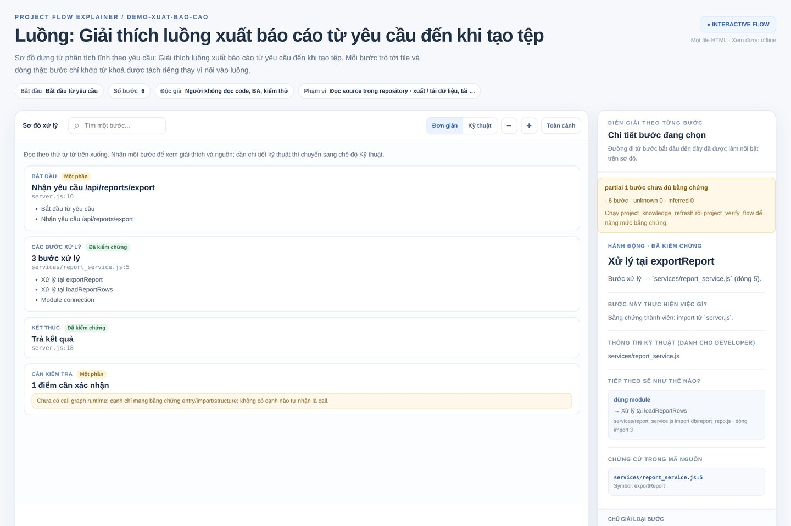

# Project Flow Explainer cho DeepSeek Harness

**ĐÃ TRIỂN KHAI** — Plugin DeepSeek Harness (DSH) dựng sơ đồ tương tác từ mã nguồn và trả vị trí làm căn cứ cho từng bước có bằng chứng. Gói chứa lõi Python. Bạn dùng plugin mà không cần tải kho mã Project Flow Explainer.



*Ảnh chụp sơ đồ HTML sinh từ kho mã mẫu.*

## Cài đặt

| Thành phần | Phiên bản |
|---|---|
| Node.js | `>=20` |
| DeepSeek Harness | Dải khai báo: `>=0.2.2-rc.2 <0.3.0`. |
| Python | Dùng Python 3.12. Lõi chỉ dùng thư viện chuẩn. |

Cài vào hồ sơ cần dùng. Ví dụ dưới đây dùng hồ sơ `pfe-test`:

```bash
dsh plugin --profile pfe-test add dsh-project-flow-explainer@latest
```

Để cài từ tệp gói, tải [bản phát hành GitHub mới nhất](https://github.com/Hieupt1904/project-flow-explainer/releases/latest) rồi chỉ định đường dẫn tệp đã tải:

```bash
dsh plugin --profile pfe-test add "$PWD/project-flow-explainer.tgz"
```

Khởi động lại DSH sau khi cài hoặc nâng cấp. Lõi phân tích không cần kết nối mạng khi chạy.

## Cấu hình

Trong giao diện web, mở **Plugins**. Tìm bundle rồi chọn **Configure** tại dòng `project-flow-explainer`. Thêm đường dẫn tuyệt đối vào **Thư mục được đọc** (`allowedRoots`), rồi chọn **Lưu cấu hình**.

| Trường | Giá trị mặc định hoặc cách dùng |
|---|---|
| `allowedRoots` | Rỗng. Điền đường dẫn tuyệt đối cho các thư mục plugin được đọc. |
| `pythonPath` | `python3`. Đổi nếu cần chọn trình thông dịch khác. |
| `coreRoot` | Plugin tự dò lõi. Chỉ đặt khi lõi nằm ở vị trí khác. |
| `timeoutMs` | `180000` ms cho mỗi lần gọi. |
| `maxOutputBytes` | `1048576` byte cho đầu ra của tiến trình con. |

Nếu dùng bản vá cấu hình, ghi đè dòng `project-flow-explainer` đã có thay vì chèn thêm dòng cùng định danh:

```yaml
- id: project-flow-explainer
  config:
    allowedRoots:
      - /duong/dan/workspace
    pythonPath: python3
```

## Sử dụng

Nhập lệnh trong giao diện web:

```text
/project-flow-explainer Giải thích luồng xuất báo cáo
/project-flow-explainer Giải thích luồng xuất báo cáo --repo /duong/dan/repo
```

Nếu bỏ `--repo`, plugin dùng thư mục làm việc của phiên. Mở `flow.html` trong `<repo>/artifacts/flows/<slug>/` để xem sơ đồ. Plugin trả đường dẫn kết quả tính từ thư mục gốc của kho mã.

| Công cụ | Dùng để |
|---|---|
| `project_flow_explain` | Dựng sơ đồ cho một luồng cụ thể. |
| `project_code_index` | Tạo hoặc cập nhật chỉ mục cục bộ. |
| `project_code_search` | Tìm theo tên hàm, tuyến xử lý hoặc từ khóa. |
| `project_context_pack` | Tìm điểm vào, tệp và kiểm thử liên quan trước khi sửa. |
| `project_impact_analysis` | Tìm luồng, hàm và kiểm thử có thể chịu tác động sau khi sửa. |
| `project_knowledge_refresh` | Cập nhật chỉ mục theo phần mã đã đổi. |
| `project_verify_flow` | Kiểm tra tĩnh sơ đồ và tệp kết quả; không chạy kiểm thử ứng dụng. |

### Lỗi thường gặp

| Mã lỗi | Cách khắc phục |
|---|---|
| `allowed_roots_unconfigured` | Điền ít nhất một thư mục tuyệt đối vào `allowedRoots`. |
| `repository_outside_allowed_roots` | Chọn kho mã nằm trong một thư mục đã khai báo. |
| `index_missing` | Chạy `project_code_index` trước khi tra cứu. |
| `core_cli_not_found` | Cài lại từ gói có thư mục `vendor/core/`. |

## Đóng gói từ mã nguồn

Chạy từ thư mục gốc của kho mã Project Flow Explainer:

```bash
node dsh-plugin/scripts/pack.mjs
node --test dsh-plugin/tests/*.test.mjs
```

Script in đường dẫn tệp gói trong trường `tarball`. Khi phát hành lên npm, dùng tệp gói này. Đóng gói trực tiếp từ thư mục `dsh-plugin/` sẽ bỏ sót lõi Python.

Xem thêm [hướng dẫn sử dụng](https://github.com/Hieupt1904/project-flow-explainer/blob/main/USAGE_GUIDE.md) và [mã nguồn](https://github.com/Hieupt1904/project-flow-explainer).
